# 幕5 全文轮次图（v2 · 两条主线 + 记忆标注）

> 从 script/ch5.yaml（v2）同步生成。每个节点是一个完整轮次：①用户消息 ②AI思考 ③选项 ④AI回复。
> **◆…◆ = 记忆候选**（①原文里的可存片段）；节点尾行“记忆：类型，线”。
> 类型：真实=本人独白｜行为=前期行为（认识到的钥匙）｜理解=前期理解（外归因的燃料）。
> 两条主线：他的焦虑｜她的回避。后期理解不入库，留幕8现场。
> ⏳=跨线时序（此拍需等另一线对应拍完成）。

## 幕5 · 男生线（全文设计稿）

```mermaid
flowchart TD
    LEG["图例：◆…◆＝记忆候选，类型＝真实／行为／理解，线＝他的焦虑或她的回避"]
    IN["幕4旗标"] -->|双问| M_A
    IN -->|仅男问| M_B
    IN -->|仅女问| M_C

    M_A["【5.1.1-A · 开场·双问】<br/>①我妹刚跟我说，那个女生昨天也找她要过我的微信！<br/>我靠，我俩这是想到一块去了？那第一句我发啥才不尬，你说<br/>②思考：用户得知对方也主动要过联系方式，情绪明显上头。<br/>需要趁热给个具体开场句，顺带提醒别用力过猛。<br/>③选项：给一句自然开场<br/>④回复：人家对你也有印象，稳了。直接发“hi，我是那天桌游的XX”，<br/>别整开场白，越随意越自然。"]
    M_B["【5.1.1-B · 开场·仅男问】<br/>①微信搞到手了，我妹那个同桌的。但我盯着输入框半小时了，<br/>第一句发啥啊，'你好'像上门查水表的<br/>②思考：用户要到了微信却卡在第一句。需要给具体话术，顺便降低他的心理负担。<br/>③选项：给一句自然开场<br/>④回复：别写你好，太正式。就发“hi，那天桌游我旁边那个，还记得不”，有记忆点又不用力。"]
    M_C["【5.1.1-C · 开场·仅女问】<br/>①出大事了，我还没鼓起勇气去要微信呢，她直接加我了！<br/>是不是我妹出卖了我？她啥意思啊这是<br/>②思考：对方主动加了用户，超出预期。需要说明这是积极信号，别让他继续脑播。<br/>③选项：告诉用户这是积极信号<br/>④回复：你管谁牵的线，人家主动加你就是愿意聊。先回“hi”，剩下的慢慢来。"]
    M_A & M_B & M_C --> M11

    M11["【5.1.11 · 第一句·慢回初显】<br/>①我发了！◆她过了四十多分钟才回◆，回了个'记得，你也要到点睡了'。<br/>这算不算冷淡啊，我盯着屏幕不知道咋接了<br/>②思考：用户开始用回复间隔衡量态度，过度解读初现。<br/>需要说明对方可能在忙，同时给出具体回法。<br/>③选项：安抚用户并给出回法<br/>④回复：四十分钟不算冷淡，人家有自己的事。这句还关心你睡不睡呢。<br/>回“还没呢，刚聊上正兴奋”，接住就行。<br/>◆记忆：行为，她的回避"] --> M111

    M111["【5.1.111 · 聊热三天·加班照片】<br/>①我们连着聊三天了，◆她回得慢但都会回◆。<br/>今天她还◆主动给我发了张加班的照片◆，配了个'困'字。我回啥<br/>②思考：对方主动分享日常，是升温信号。需要让用户把“困”接住，表达关心但不过火。<br/>③选项：顺着照片关心一下<br/>④回复：主动发照片是好事，她想让你看到她的状态。<br/>回“困就早点收工，别熬秃了”，关心到点上，再多就腻了。<br/>◆记忆：理解，她的回避（2条）"] --> M1111

    M1111["【5.1.1111 · 在干嘛轰炸·上头自察】<br/>①我现在◆一天能给她发八百条'在干嘛'◆，她有时候隔俩小时才回。<br/>◆发完我就盯着她朋友圈刷◆，我是不是有点上头了<br/>②思考：用户意识到自己上头，这是他第一次把焦虑说出口。<br/>需要肯定他的觉察，给减频建议，别吓着他。<br/>③选项：肯定觉察，建议降低频率<br/>④回复：能意识到就还不算上头。试试一天两三条，挑她方便的时候发。<br/>你越从容，聊得反而越舒服。<br/>◆记忆：真实，他的焦虑（2条）"] --> M21

    M21["【5.2.1 · 约局参谋】<br/>①光线上聊不行了，我想约她出来吃个饭，周六。<br/>你说咋开口，会不会显得我很急<br/>②思考：用户要从线上转线下，需要具体邀约话术，并解释邀约本身不丢人。<br/>③选项：给出邀约话术<br/>④回复：不急，都聊一周了。直接说“周六有空吗，我知道一家店评价不错，<br/>带你去尝尝”，具体时间加具体事，比干问“有空吗”强十倍。"] --> M211

    M211["【5.2.11 · 改期失落】<br/>①◆她周六去不了了，说项目临时有事，改周日◆。<br/>语气倒是挺好的，但我咋觉得……她是不是其实不想来<br/>②思考：用户把改期往坏了解读。实际情况是对方真的加班，玩家在另一侧可见。<br/>需要拦住脑补，给个得体的回应话术。<br/>③选项：安抚用户并给回应话术<br/>④回复：项目的事身不由己，她还主动提了改周日，这就是想来的意思。<br/>回“行，那周日，你忙你的”，懂事又不黏人。<br/>◆记忆：行为，她的回避"] --> M2111

    M2111["【5.2.111 · 见面复盘·他版】<br/>①见完了！吃饭散步都挺好，就是◆她中间回了好几条工作消息◆，我干坐着。<br/>不过◆我说了个特冷的笑话她居然都笑了◆，还问我下次想吃啥<br/>②思考：对方问下次是明确的好信号，用户却纠结看手机的事。<br/>需要把他的注意力引向积极面。<br/>③选项：点出“下次”信号<br/>④回复：注意重点：她说的是“下次”，这比啥都强。回工作消息是成年人常态，<br/>别往心里去。她能跟你散完这一路，就是舒服。<br/>◆记忆：行为＋理解，她的回避"] --> M31

    M31["【5.3.1 · 复盘收束·求确认】<br/>①你说我是不是真的有戏？◆我一个社恐，<br/>上次跟人这么连着聊，对象还是我表妹◆<br/>②思考：用户语气认真，在寻求确认。社恐的自嘲是真话，不是段子。<br/>需要给正向评估，同时记住他这句自我暴露。<br/>③选项：给出正向评估<br/>④回复：数据不骗人：秒回你、主动发照片、约完还问下次，<br/>这要没戏我就白分析了。有戏，就差临门一脚了。<br/>◆记忆：真实，他的焦虑"] --> M41

    M41["【5.4.1 · 表白排练】<br/>①我想跟她表白。◆话我打好又删了七八遍了，越删越不敢发，手心全是汗◆。<br/>你帮我看一眼：'我挺喜欢你的，想正经跟你处对象，你考虑考虑'<br/>②思考：用户的焦虑全写在删改次数和手汗上了，这句话的真实诉求是要一个敢按发送键的理由。<br/>需要把话术改自然，顺便接住他的紧张。<br/>③选项：帮他改表白话术<br/>④回复：意思对，“考虑考虑”太像面试，改成“跟你在一块特别舒服，我挺喜欢你的，<br/>想跟你处对象，你要是也觉得行咱就试试”。另外说一句：删七八遍不是怂，是真在乎。<br/>◆记忆：真实，他的焦虑"] --> M411

    M411["【5.4.11 · 表白结果】<br/>①发了！！她过了半小时回的……'我也想试试，<br/>只是◆我可能不太会谈恋爱◆，你多担待'。我靠？？这是答应了吧！<br/>②思考：对方答应了，还提前交底自己不擅长亲密关系。<br/>用户光顾着高兴没细品这句。先道贺，再轻轻标记这句话。<br/>③选项：道喜，并提醒记住她这句交底<br/>④回复：是答应了，恭喜。另外把她那句“不太会谈恋爱”记下来，这是提前交底。<br/>哪天她做得笨拙了，你就想起今天这句话。<br/>◆记忆：行为，她的回避"] --> EXIT
```

## 幕5 · 女生线（全文设计稿）

```mermaid
flowchart TD
    IN["幕4旗标"] -->|双问| F_A
    IN -->|仅女问| F_B
    IN -->|仅男问| F_C

    F_A["【5.1.1-A · 开场·双问】<br/>①我同桌说漏嘴了，那个表哥前两天也找她要过我的微信。<br/>等于我俩是互相要的？？那我现在先说话，会不会显得我知道这事似的<br/>②思考：双方都主动要过联系方式，用户表面纠结实则开心。<br/>需要给个自然开场，别让她端着。<br/>③选项：给出自然开场方案<br/>④回复：互相都惦记着，谁先开口都不掉价。就发“hi，同桌牵线那位”，<br/>把窗户纸点破了，他准松一口气。"]
    F_B["【5.1.1-B · 开场·仅女问】<br/>①我同桌把表哥微信推给我了，让我先加。我有点不好意思，<br/>你说是我加他合适，还是等他加我<br/>②思考：用户在纠结加微信的顺序，本质是怕显得主动。<br/>需要告诉她主动不等于掉价，给具体做法。<br/>③选项：建议直接加，说明主动不掉价<br/>④回复：都推微信了还讲究谁先点发送？你加他，备注“桌游那位”，大方点。<br/>等他加你，说不定等一礼拜。"]
    F_C["【5.1.1-C · 开场·仅男问】<br/>①那个表哥加我微信了，就桌游那天见过的。有点意外，<br/>我都快忘了这茬了。通过了说点啥<br/>②思考：对方主动联系，用户态度平淡中带一点意外。<br/>不需要推动她热情，给个自然的回应即可。<br/>③选项：给个自然的回应建议<br/>④回复：先通过，回个“hi，那天桌游的”，看他聊啥再定。<br/>不感兴趣的话题礼貌收住就行，不用有压力。"]
    F_A & F_B & F_C --> F11

    F11["【5.1.11 · 慢回的真相】<br/>①◆他消息回得也太勤快了◆……我一下班攒了一堆没回的。<br/>◆不是不想回他，是不知道说啥◆显得有意思<br/>②思考：用户不是冷淡，是疲惫加上不会表达，这点她自己都说不清。<br/>需要给她减负方案，别硬聊。<br/>③选项：给她减负的回法<br/>④回复：累就直说“下班瘫了，今天不想动脑子”，比硬撑着尬聊强，他反而踏实。<br/>攒着的话题挑个有精神的晚上回，质量比数量值钱。<br/>◆记忆：行为（他的焦虑）＋真实（她的回避）"] --> F111

    F111["【5.1.111 · 她的热闹】<br/>①他今天夸我开朗，说我性格好。其实◆我朋友是挺多的，周末局从来不断◆，<br/>◆我跟谁都能聊起来◆。他跟我反着来，安安静静的<br/>②思考：用户描述自己的社交面：广、热闹、跟谁都聊得来，语气是自豪的。<br/>她把广而浅当作性格好。需要接住她的开朗，轻轻留一个观察角度。<br/>③选项：顺着她接住她的开朗<br/>④回复：开朗是真开朗，人缘好也是本事。不过你可以留意下：<br/>这么多热闹里，有没有一个人是你累了、烦了也想单独找的。<br/>有的话，那个人比一百个局都值钱。<br/>◆记忆：真实，她的回避（2条）"] --> F1111

    F1111["【5.1.1111 · 打岔·他没追问】<br/>①他今天问我家是哪的、家里什么情况，我岔开聊别的了，<br/>◆他也没追问◆。还挺好的，不逼人，换个人我早烦了<br/>②思考：用户对深挖式提问敏感，回避深层话题是习惯。<br/>对方没追问让她感到舒适。需要肯定这种节奏，不点破她的回避。<br/>③选项：肯定这种相处节奏<br/>④回复：他这个分寸感确实难得。你想说的时候自然会说，不想说就岔开，<br/>这样相处不累。节奏舒服比聊得多重要。<br/>◆记忆：理解，他的焦虑"] --> F21

    F21["【5.2.1 · 约局接收】⏳等男生5.2.1<br/>①他约我这周六吃饭，我答应了。◆他一天能问我三遍'在干嘛'◆，<br/>约会倒是他先开口的。不过周五有个项目节点估计得加班，<br/>万一周六起不来就得鸽他……见面我得注意点啥<br/>②思考：用户答应了约会，但埋了个加班的不确定因素，她自己没当回事。<br/>前面那句“一天问三遍”是随口说的。需要给见面建议，轻提一句守约。<br/>③选项：给见面建议，轻提守约<br/>④回复：少玩手机，多接他的话就行，你本来就擅长听。<br/>另外周六要真来不了，提前一天说，别当天鸽，换谁都会多想。<br/>◆记忆：行为，他的焦虑"] --> F211

    F211["【5.2.11 · 临时改期】⏳等男生5.2.11<br/>①真让你说中了，项目炸了周六去不了。我跟他说改周日，<br/>他就回了'行，你忙你的'。就五个字，他是不是不开心了<br/>②思考：用户察觉到对方回复变短，开始在意他的情绪，说明她其实期待这次见面。<br/>需要给她一个把话说暖的话术。<br/>③选项：鼓励她把话说暖一点<br/>④回复：多少有点失落，五个字是他懂事的极限了。<br/>补一句“周日我请你，给你赔罪”，他就又活了。<br/>你主动补这一句，比啥都强。"] --> F2111

    F2111["【5.2.111 · 见面复盘·她版】<br/>①周日见完了，还行。全程我拿主意，◆吃啥逛哪他都说行◆，有点闷但也省心。<br/>我中途回了几个工作消息他也没说啥。对了，他讲了个特冷的笑话，<br/>◆我看气氛要僵就配合笑了一下◆，他还挺高兴<br/>②思考：用户对'全程他没意见'有一丝说不清的违和，但马上会自我消化。<br/>那个配合的笑是她浅层社交习惯的显形。先接住直觉，别急着定性。<br/>③选项：接住她的直觉，暂不定性<br/>④回复：有点闷正常，刚线下接触都这样，他可能慢热。<br/>你违和的这点先记着，再见两次看看是紧张还是真没主意，别急着下结论。<br/>◆记忆：理解（他的焦虑）＋真实（她的回避）"] --> F31

    F31["【5.3.1 · 复盘收束·替他找理由】<br/>①想明白了，闷就闷点吧，◆跟他待着不用费脑子，挺省心的◆。<br/>而且我岔开前男友话题的时候他都没追问，这种体贴不多见<br/>②思考：用户主动把违和感消化成了优点，替对方找了理由。<br/>这是糖，也是滤镜。需要顺着她，轻轻保留一点观察空间。<br/>③选项：顺着她，保留观察空间<br/>④回复：省心是真的，体贴也是真的，现阶段这样就挺好。<br/>真在意一个人之前，先把“跟他待着舒不舒服”多验证几回，<br/>你的直觉比你的说服力准。<br/>◆记忆：理解，他的焦虑"] --> F41

    F41["【5.4.1 · 表白收到·回避内心】⏳等男生5.4.11<br/>①他跟我表白了。我有点慌……不是不喜欢，◆我就是怕太深入。<br/>我一跟人深入就搞砸◆，你说我这样的人适合谈恋爱吗<br/>②思考：用户第一次半露内心：怕深入、怕搞砸。这是她最核心的恐惧。<br/>不能催她，也不能替她做决定，帮她把恐惧说清楚。<br/>③选项：帮她说清楚恐惧，不替她做决定<br/>④回复：别急着定型适不适合。你怕的不是他，是“深入以后搞砸”这个想象。<br/>那就按你的节奏来：答应他，同时把你这条底线直接告诉他，<br/>能接住的人不会吓跑。<br/>◆记忆：真实，她的回避"] --> F411

    F411["【5.4.11 · 答应·手在抖】<br/>①我跟他说试试了，还照你说的把'我可能不太会谈恋爱'也说了。<br/>发出去那秒手都在抖……但好像，也没那么可怕<br/>②思考：用户迈出了自己最怕的一步，还能把底线提前交底，进步明显。<br/>需要肯定这个突破，收在轻松的基调上。<br/>③选项：肯定她的突破，轻收尾<br/>④回复：注意你刚干的事：怕深入的人主动说了“试试”，还提前交了底。<br/>这比任何情话都硬核。手抖说明是真的在意，这不丢人。"] --> EXIT2
```

## 幕5 · 跨线时序与出口

- 女生 5.2.1 等男生 5.2.1（他先开口约）→ 女生 5.2.11 等男生 5.2.11 → 女生 5.4.1 等男生 5.4.11（他先表白）。
- 双方 5.4.11 都完成 → 出口：**在一起=true** → 进块6+7。
- 幕5 只做记忆产出，判定挂 8.5（认识到=本线行为类≥2；外归因永远可选）。
