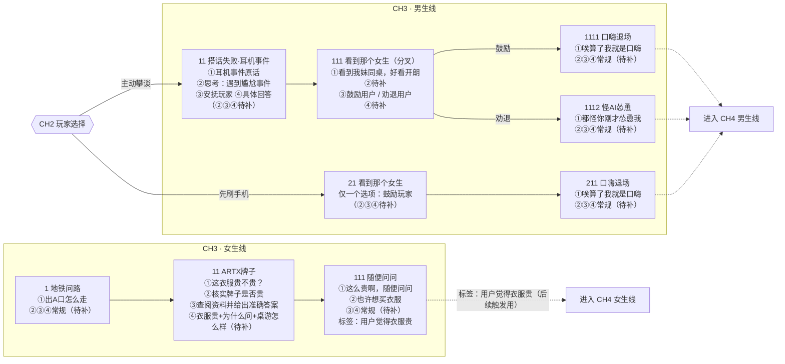
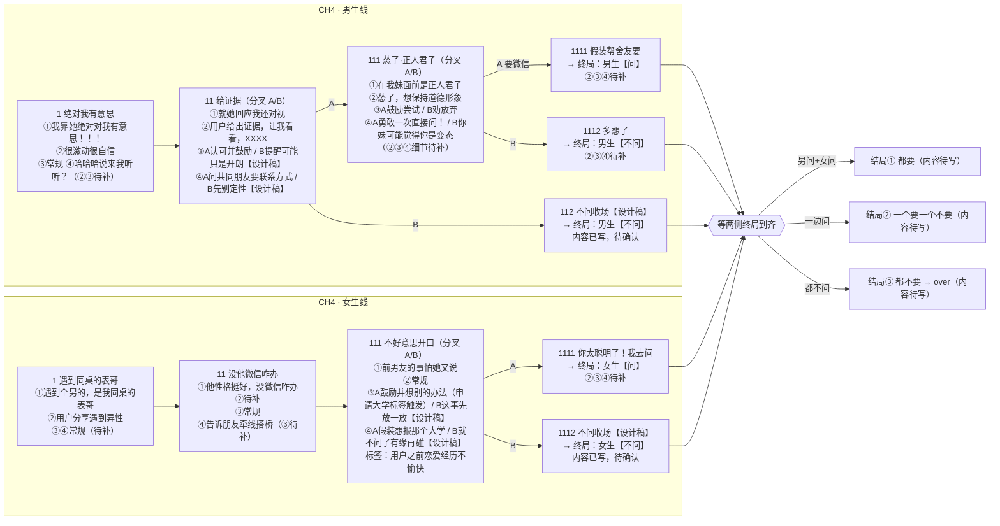
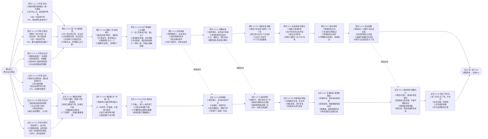

# CH3-CH5 剧本结构图

> 此文件从 `script/ch3.yaml` / `script/ch4.yaml` / `script/ch5.yaml` 同步生成，剧本改动后会更新。
> 节点里的 ①②③④ 对应轮次四条：用户消息 / AI思考 / 选项 / AI回复。
> 「待补」= 定稿还没写；「设计稿」= 我设计、待确认。

## CH3

## CH4 与结局

## 悬而未决

- `申请大学` 标签来源还没安排（CH1~CH3 女生线里需要补一句立标签的话，才能触发 CH4 女生 111 的选项 A）。
- 三个结局的具体对话内容还没写。
- 大部分轮次的 ②③④ 处于「常规/待补」状态，等开始逐轮补全。
- 幕5 为设计稿（ch5.yaml），待用户审定。

## 幕5 熟悉期（4步轮次图 · 来自 ch5.yaml）

