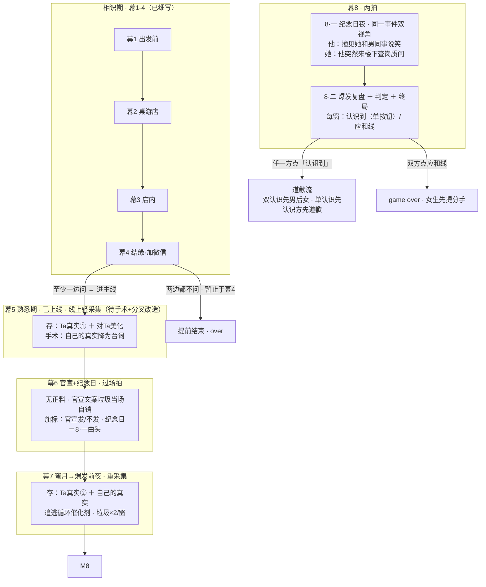
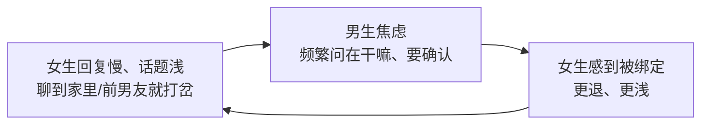

# 游戏宏观大纲（v3）

> 2026-11 起：项目入口是 [AGENTS.md](../AGENTS.md)，本文件是宏观定稿层；个别早期段落存在历史残留，以 AGENTS.md 与 script/ch*.yaml 为准。
> **2026-11-07 结构定稿**：5-8 章按「记忆矩阵体系」重排（见「结构定律」「记忆体系」两节）——幕8 砍成两拍、判定挂 8·二、终局只余道歉流/game over 两种；旧幕8 四节拍、A/B/C/D 结局矩阵、关系值全部废案（文中标【废案】留档）。剧本未写：顺序＝飞书审流程图（script/act5-8-structure.mmd）→ 故事层定稿 → 才填①②③④。
> 载体铁律（写作时时刻自检）：剧本唯一载体是「角色↔AI」聊天轮次，情侣互动永不直接出现，只能经由「转述复盘 / 实时求助 / 引用原话」进入聊天，详见「载体规则」一节。

## 一句话主题

恋爱初期的滤镜本质是投射：匮乏的人把自己缺的东西投到对方身上，以为对方能填补自己；熟悉让滤镜褪去，露出一个和自己一样的普通人。此刻的选择——换掉，还是认清幻想与真实的落差后仍然留下——交给玩家，游戏不评判。

## 玩法与主题的咬合

- 玩家 = 同一个 AI，同时在男生、女生两部手机里。
- 全游戏只有玩家同时看到两侧视角；两个角色各自只见自己的一半——这就是「通过 AI 看到两个人冲突」。
- 8·二 判定点上，每窗只有一个「认识到」按钮（集齐条件才出现，内部按认识自己/对方/都认识出不同句子，玩家无感知）和一条永远可选的应和线。**终局只看玩家点的是哪个**：任一方点「认识到」→ 道歉流；双方点应和线 → game over。机制本身即主题：能看见全貌的只有玩家，但接不接镜子是玩家的选择。

## 人物内核

男生（焦虑型）：
- 外冷内热，看着社恐不爱社交，内心其实能敞开。
- 家庭条件不错，但生活无趣、没冲劲，孤独，缺乏动力。
- 匮乏：渴望被热情点燃、被回应，渴望有人拉他出一个人的世界。

女生（回避型）：
- 看着热情开朗，实际是对深层关系的恐惧——情感广而浅，不敢深入。
- 独立、事业心强，不愿敞开内心，物质上要靠自己奋斗。
- 匮乏：渴望一个稳定、无条件接得住自己的容器。

投射与破灭的镜像（爱上的特质 = 爆雷的特质）：

| 相识期读到的是 | 冲突期看到的是 |
|---|---|
| 女生的热情开朗 | 热情给所有人，唯独深入不进来 |
| 女生的独立上进 | 不需要他，事业永远在他前面 |
| 男生的稳重接纳 | 稳=低能量没主见，冲突一来就焦虑上头 |
| 男生的家境 | 物质宽裕但情感荒漠，不懂她的挣扎 |

## 全游戏结构

相识期（幕1-4，已可玩）→ 结缘岔口 → 幕5 熟悉期（已可玩，待手术+分叉改造）→ 幕6 官宣+纪念日（过场拍，未写）→ 幕7 蜜月→爆发前夜（未写）→ 幕8 两拍（8·一 导火索双视角 / 8·二 爆发+判定+终局）。

## 宏观总图

## 章法：矛盾驱动，一路多开

全剧抓住 2~3 个核心矛盾。**同一个矛盾，在两种终局里有不同展开**——不写「一个事件只通向一个走向」的流水账，而是矛盾摆在那里，game over 线是它的表层循环（永远停在遮掩形态里吵），道歉流是它的深层解法（看清楚还愿意留下）。

## 结构定律（2026-11-07 立）

**矩阵仅 4 格 × 记忆槽位有限 × 产出/使用频率必须稳定 → 故事线长度被硬性约束。**

没有记忆系统时剧本想写多长写多长；有了记忆经济，每多一章就多一批候选、稀释一次 4 格矩阵的密度。因此：幕8 必须短（两拍）；5/7 各只采一轮正料（每窗 4 条）；幕与幕之间的**故事时间必须压紧**——幕7 到 8·二 只隔几天，5/7 存的记忆到 8·二 必须是「刚存不久还没用过」的合理距离，不能出现「隔了那么久不用很奇怪」的违和。任何加章、加轮次的提案先过这条定律。

## 三大矛盾引擎

### 矛盾①（主引擎，必保）：浅层热情 ⟷ 确认饥渴

追逃循环闭环：

- 心动期读法：她是好忙好独立；他是好在乎我（被完美的人一直关心，安全感+幸福）。
- 真相：男生只是因为回应少心里急，想多聊聊把关系往前推——**这恰恰是女生想要但藏起来的东西**；女生不是不喜欢，是不愿暴露内心、不知道怎么表达（不是不喜欢你这个人，只是我不熟悉这样，我不知道怎么回应）。
- 层次：**幕5 轻、幕7 重、幕8 才吵开**。幕5 只是端倪，双方都不烦——他的焦虑指向「想靠近」，她的回避指向「保持节奏」。幕7 已是爆发前期：同一套内核在，人还忍着，只跟 AI 吐槽、双方不开吵；他的焦虑转向「要透明」（监视、猜疑、控制欲萌芽），她的回避转向「关闸」（对最近的人懒得解释，第一次觉得烦、烦完又愧疚）。幕8 才把遮掩形态喊出来（视奸、查岗、「你变了」），真实内核（他怕被抛下、她怕被吞没）仍然不由角色自己说破。
- 爆发形态（8·二）：男生指责她敷衍、不在乎、冷漠；女生越被要求越冷。真实记录里整场架都停在遮掩形态（「你对谁都热络唯独不跟我分享」「你视奸我 / 你太闲」），内核一个字不出现——这就是 8·二判定存在的理由。
- 各终局展开：
  - game over：为这事没完没了地吵，永远停在表层，谁也不往深走一步，女生先提分手。
  - 道歉流：至少一方停下来看见真相——Ta 就是那样的人（Ta真实），我给Ta套过滤镜（对Ta美化）；我也有我的不体面（自己的真实＋自我的美化）。道歉模板把三个认识情况收束成同一句话。

### 矛盾②（导火索事件）：对外人热络 ⟷ 对爱人疏远

- 新设计（2026-11-07）：**8·一 纪念日夜＝同一事件双视角**——他带惊喜/宵夜去她公司楼下，撞见她和男同事有说有笑走出来（当初心动的同款笑声），她一见他笑容收起「你怎么来了，不是说改天吗」；她的视角＝他突然出现、脸色不对、质问她为什么和同事走得近。矛盾①在导火索里一次点透：她对外壳热、对安全区冷，他读到「我不特殊」。
- 【废案】原「8.1 纪念日细案＋8.4 朋友局」两次引爆设计作废（幕8 两拍装不下两场事件；朋友局素材留档，可作 8·二 吵架弹药），见文末废案区。

### 矛盾③（背景级）：生活动力落差

- 男生对什么都「行、挺好的、随便」→ 没主见没冲劲（伏笔埋着，不单独放大冲突）。
- 爆发时作为吵架弹药出现：女生骂他无聊、不上进、没前途；男生觉得她的世界里事业永远排他前面。
- 呼应两人出身：他物质宽裕但情感荒漠；她一无所有所以只能拼。

## 幕5~7（2026-11-07 结构定稿）

**幕5 熟悉期（已上线，待手术+分叉改造）。** 内容保留现有 `script/ch5.yaml`：线上日常→表白→答应。记忆手术：男窗「八百条在干嘛」、女窗「怕太深入」**从候选降为台词**（「自己的真实」归 7 章产出），留下每窗两条正料——Ta真实①（男窗＝她交底那句「不太会谈恋爱」；女窗＝他当面交底「半夜还在刷你朋友圈」）＋对Ta美化（男窗＝「都会回」；女窗＝「家里有爱」）。**另有硬性改造：幕5 现在是一条线走到黑，要加真分叉（选项有感），分叉形态在故事层定。**

**幕6 官宣+纪念日（过场拍，未写）。** 无正料。事件：他想官宣、拟文案；她犹豫要不要也发（他的官宣经转述进她的窗，合法跨线）；顺势定下纪念日。垃圾「官宣文案」双窗各一条，**当场自销**（存了→AI 回复多一句引用；没存→通用版，剧情照走）。旗标：官宣发/不发（8·二 可回声）、纪念日档期（**8·一 的由头**）。

**幕7 蜜月→爆发前夜（未写）。** 重采集＋追逃循环升级。正料每窗两条：
- 男窗：她的真实②——「几天不发一条消息、吵架就不说话」量级；自己的真实——监视猜疑的坦白（翻她社交记录、数她给谁评论，「知道不正常但停不下来」）。
- 女窗：他的真实②——「他监视我社交账号、会猜疑我」；自己的真实——逃避冷暴力的坦白（吵架就不说话、对最近的人懒得解释）。

注意两窗素材是**同一循环的两面**：她眼里的「被监视」＝他嘴里的「我停不下来」；他眼里的「几天不发消息」＝她嘴里的「我逃避」。幕7 需要一颗小冲突的种子（让她「吵架就不说话」成立）。旧候选事件（报备不对等 B2、在线不回 D1）保留为素材，故事层可选用。垃圾每窗 2 条（自销＋纯占）。

**写作纪律**：写 6/7/8 前重读真实吵架记录（本地：`C:\Users\86181\WorkBuddy\2026-11-06-00-14-13\2026-11-04-争吵记录.md`，私人素材**不进仓库**）；追逃循环（她回避→他焦虑要确认→她更不沟通→他更疑→她冷暴力）是**催化剂**——读一遍内化其逻辑，产出自然贴合，不是照框架填空。真实记录已验证方法论：整场架全停在遮掩形态，内核一个字没出现。

## 记忆体系（2026-11-07 定稿）

每个窗一个 2×2 矩阵：对象（Ta/自己）× 内容（真实/美化）。

| | 真实 | 美化 |
|---|---|---|
| **Ta** | **Ta的真实**：Ta 就是这样的（她就是回避/他就是要确认），事实层 | **对Ta的美化**：我把Ta读成了独立、有爱、稳重，滤镜层 |
| **自己** | **自己的真实**：我实际在做（监视猜疑/逃避冷暴力），说漏的，最多半觉察 | **自我的美化**：我给自己的辩护词（我这是在乎/我只是太忙），全然真诚 |

**章节分布与存储**：5 章＝Ta真实①＋对Ta美化（存）；7 章＝Ta真实②＋自己的真实（存）；8 章＝Ta真实·严重版＋自己的行为＋自我的美化（**全 live，现成台词，不入槽**）。每窗正料 4 条、**槽位 6 格**（4 正＋2 余量）。幕1-4 教学记忆进幕5 时清空（引擎已实现）；5/7 的存档留到 8·二，中间不清。

**旧称呼对照**（ch5.yaml 文件头在手术前仍是旧词）：钥匙＝Ta的真实，糖＝对Ta的美化，自白＝自己的真实，自糖＝自我的美化。

**垃圾记忆（每窗 5 条＝自销 3＋纯占 2）**，分布 5 章×2 / 6 章×1 / 7 章×2：
- **自销**＝存了之后在指定拍 AI 回复多/变一句（零分支影响）：男窗「想吃烤肉」（7 章约饭建议消耗）、女窗「同桌是表妹」（7 章组局由头消耗）、双窗「官宣文案」（6 章当场消耗）、男窗 7 章新垃圾（如她公司楼下的奶茶店名，**8·一 消耗**：他带宵夜时 AI 提「带她常点的那杯」）、女窗 7 章新垃圾（如他报备里的傻细节，7 章夜聊消耗）。
- **纯占**＝永无回报，纯引诱占槽：男窗「猫叫煤球」＋7 章 1 条（如同事外号）；女窗「头像是小熊」＋7 章 1 条（如他兄弟的外号）。
- 具体条目在故事层按剧情长出的实物替换，机制不变。
- 玩家体感目标：垃圾候选比正料多，想全收正料只能再捡 2 条垃圾，必须在垃圾里做取舍；自销型看着有用、纯占纯赌——「大部分记忆不是感情线的，但存了的确有区别」。
- 引擎：自销与 8·二 判定共用同一个特性——**「AI 回复按记忆池持有情况出变体」**（此前搁置的软效果，幕8 剧本成型时实现，不挡 6/7 写作）。

**8·二 判定公式（每窗，同一位置）**：

| 玩家状态 | 出现条件 | AI 输出用哪些元素 |
|---|---|---|
| 认识到自己 | 存了 **7 章自己的真实**（仅此一条即可） | 7 章自己的真实（存档）＋8 章自我的美化（live）＋8 章自己的行为（live），三点一起说 |
| 认识到对方 | 存了 **5 章对Ta的美化**（必须）＋〔5 章或 7 章 Ta真实，至少一条〕 | 只用触发的点**堆叠句子**（美化句/真实句/A+B），元素同源，不加额外内容 |
| 应和线（默认） | 永远可选 | 8 章 Ta真实＋8 章自我的美化＋8 章自己的行为——AI 全用现成素材**应和**玩家（玩家骂什么跟着说什么） |

呈现：每窗只有两个选项——「应和线」永远有；「认识到」**只有一个按钮**，集齐任一条件才显示，点下去内部按认识自己/对方/都认识三种情况出不同句子，玩家无感知。**终局跟玩家点的选项走，不跟存档**：集齐了也可以硬点应和线——镜子递到面前不接，本身就是选择。

**终局（两种，2026-11-07 定稿；旧 A/B/C/D 矩阵废案，D 弃用）**：
- 任一方点「认识到」→ **道歉流**：双认识→先男后女；单认识→先认识的那方先道歉。道歉模板男女各一套固定文案（说自己不对＋不该给对方滤镜，把认识自己/对方/都认识三种情况收束成同一句——玩家注意不到这些细节，在此收束）。经各窗转述呈现：道歉方先跟自己 AI 说要去道歉→（情侣间道歉真实发生，不直接出场）→对面窗转述收到→那边 AI 劝「你也去」→第二次道歉返回。
- 双方都点应和线 → **game over，女生先提分手**。
- 双认识与单认识道歉后是**同一个结局**。

## 载体规则：吵架怎么名正言顺地进AI聊天（幕8写作的第一约束）

剧本的唯一载体是「角色 ↔ AI」的聊天轮次。情侣之间的互动**永远不直接出现在剧本里**，只能通过三种方式进入聊天。每拍开写前做动机检测：**背景情况能合理解释「这个人此刻确实在跟AI聊」即可**——比如两人本来就在家刷手机、睡前习惯性找AI唠两句、受了挫想找人倒苦水。不设固定清单，能站得住就行；背景撑不住的轮次=角色在给玩家演话剧，穿帮。

### 三种进入方式

1. **转述复盘（事后，主通道）**：吵完/受挫后，各自把事情倒给AI听。关键：**两个人讲的是同一场架，版本却完全不同**——玩家拿到两份带偏见的叙事，并排对照才接近真相。**信息差即张力**。
2. **实时求助（事中，战术通道）**：吵架进行中躲进房间/工位，问AI「她回我“随便”是什么意思」。此刻玩家的回复会变成角色发给对方的话——**玩家是两个人的共同军师，亲手给双方的战书和情书执笔**。
3. **引用原话（文本道具）**：把对方的消息截图/引用给AI看。吵架原文以引文形式出现在①用户消息栏里，剧本从未离开聊天界面半步。

### 幕8两拍的载体分配（2026-11-07）

- **8·一 纪念日夜**：当夜双线转述复盘（同一事件两个版本并排）——他侧：越想越酸，撞见她对同事笑、对他收起笑；她侧：他突然来楼下查岗质问，好累、根本没意识到他受伤。live 产出两侧「Ta真实·严重版」。
- **8·二 爆发+判定**：那晚/次日的情侣微信大吵以引用原话截图进场，双窗暴怒复盘；随后 AI 对账判定（应和线/认识到按钮）→ 道歉流或 game over。旧 8.2 微信第一架、8.3 查岗滚动、8.4 朋友局的素材（「你能不能成熟点」等狠话）压缩进这两拍之间的叙述与吵架弹药。

## 幕8 两拍（2026-11-07 定稿）

- **8·一 导火索·同一事件双视角**：纪念日（幕6 定档回收）他带惊喜/宵夜去她公司楼下——男窗：撞见她和男同事有说有笑走出来（当初心动的同款笑声），她一见他笑容收起「你怎么来了，不是说改天吗」；女窗：他突然出现在楼下、脸色不对、质问她为什么和同事走得近。当夜双线转述复盘。live：Ta真实·严重版（双窗各一条）。
- **8·二 爆发+判定+终局**：那晚或次日情侣微信大吵（引用原话截图进场；双方的狠话 live 产出），双窗暴怒复盘 → AI 对账判定（每窗：应和线永远可选/「认识到」按钮按记忆池条件显示，公式见「记忆体系」）→ 道歉流或 game over（女生先提）。
- 内核注解（只有玩家可见）：她对外的笑是浅层社交保护壳——对不熟的人反而轻松；对他的「冷淡」是把安全区的信任读成了「我不特殊」。他的突然查岗是把「怕被抛下」演成了「要确认」。巨大信息差，只有玩家拼得出全貌。

## 关系值（已废案）

- 【废案 2026-11-07】数值系统自始未实现；其唯一挂钩（C/D 终局分岔）随旧结局矩阵一并作废。留档：原案初值幕4 双问=高、单问=低；2026-11-05 曾标暂缓，现随四结局废案彻底失去用途，不再考虑。

## 终局（2026-11-07 定稿，取代旧「幕9 结局矩阵」）

幕9 不再是独立章：终局长在 8·二 判定之后。

| 8·二 双窗选择 | 终局 |
|---|---|
| 任一方点「认识到」（双认识/单认识/只认识自己或对方皆算） | **道歉流**：先道歉方顺序＝双认识先男后女、单认识先认识方；道歉模板男女各一套固定文案（说自己不对＋不该给对方滤镜）；先道歉方先跟自己 AI 说要去道歉→对面窗转述收到→那边 AI 劝「你也去」→第二次道歉返回。双认识与单认识＝同一个结局。 |
| 双方都点「应和线」 | **game over：女生先提分手**。吵的从来不是事，是各自没被满足的匮乏——永远停在遮掩形态。 |

> 【废案留档】旧四结局矩阵（2026-11-05 版）：

| 男生 | 女生 | 旧结局 |
|---|---|---|
| 外归因 | 外归因 | A 不欢而散 |
| 认识到 | 外归因（或反之） | B 一方坚持，一方放弃 |
| 认识到 | 认识到 | C 坚守 / D 和平分手（C/D 分岔依据待定，关系值方案暂缓） |

## 精神分析层的表达方式

不给角色讲理论。用行为让观众自己看出：game over 里两人吵的从来不是事情本身，而是各自未被满足的匮乏；道歉流的转机不是「问题解决了」，而是「看清楚了还愿意留下」。

## 作品集篇幅策略

- 相识期（幕1-4）：已细写，约占前三分之一。
- 幕5-8：结构定稿（2026-11-07），剧本待写；写作顺序＝飞书审流程图（script/act5-8-structure.mmd）→ 故事层定稿 → ①②③④。幕8 两拍是作品集核心展示位（判定+道歉流/分手全在这里）。
- 旧「幕9 每结局一小段」随四结局矩阵废案；终局长在 8·二。

---

# 【废案区 2026-11-07】旧幕8 设计（8.1~8.5 四节拍 + 纪念日细案）

> 砍成两拍的原因：四节拍＝四轮架，战线过长，违反结构定律（5/7 存、8 章用，中间空转四拍没有产出利用）；真实故事时间拉太长不使用记忆也不合理。以下全部作废留档。

## 旧「幕8-1 纪念日事件细案」（8.1 导火索）

- 铺垫：男生提前订好餐厅、准备纪念日惊喜，指望这顿饭找回热恋感。
- 8.1a：女生临时加班，说改天补上——她真心觉得工作优先很正常，不是敷衍他。
- 8.1b：男生不甘心，带着宵夜去公司楼下等，撞见女生和同事有说有笑走出来——**那是他当初心动时的同款笑声**。
- 8.1c：轮到他上前，女生瞬间收起笑：「你怎么来了，不是说改天吗」，疲惫敷衍，只想回家。
- 8.1d：男生当场没发作，回家越想越酸：对谁都热情，唯独对我最疏远。
- 内核注解（只有玩家可见的双侧真相）：女生对外的有说有笑是浅层社交保护壳——对不熟的人反而轻松；对他「冷淡」是因为把他当成能松口气的安全区，**恰恰是信任的表现**。男生读到的是「我不特殊」。
- 处置：事件内核（楼下撞见+收起笑）保留，收进新 8·一；分步细案作废。

## 旧「幕8 节拍」（8.1~8.5）

- 8.1 小导火索：纪念日事件（细案如上）。
- 8.2 滤镜初裂：第一次争吵，双方第一次看见对方「滤镜外」的样子。情侣微信上的第一场架——两侧实时求助+引用原话，玩家眼看自己写的回复把火烧大或压小。
- 8.3 追逃循环升级：多轮拉扯。焦虑型追（要回应、要确认、翻旧账「你以前不是这样的」），回避型逃（加班、冷淡、「你能不能成熟点」）。
- 8.4 至暗点：导火索二——女生的朋友局，男生全程被晾：她对谁都热络，唯独顾不上他。散场路上他绷不住爆发，她一句「你能不能成熟点」点燃大吵。**over 闸门**：双方都选绝情则当场散场。
- 8.5 认识时刻：每侧外归因永远可选；「认识到」由本窗钥匙开门。
- 处置：8.2/8.3 素材收进 8·二 吵架弹药与两拍间叙述；**8.4 朋友局整场作废**（「被晾」「你能不能成熟点」可作 8·二 吵架原话素材）；8.5 判定功能收进 8·二。
