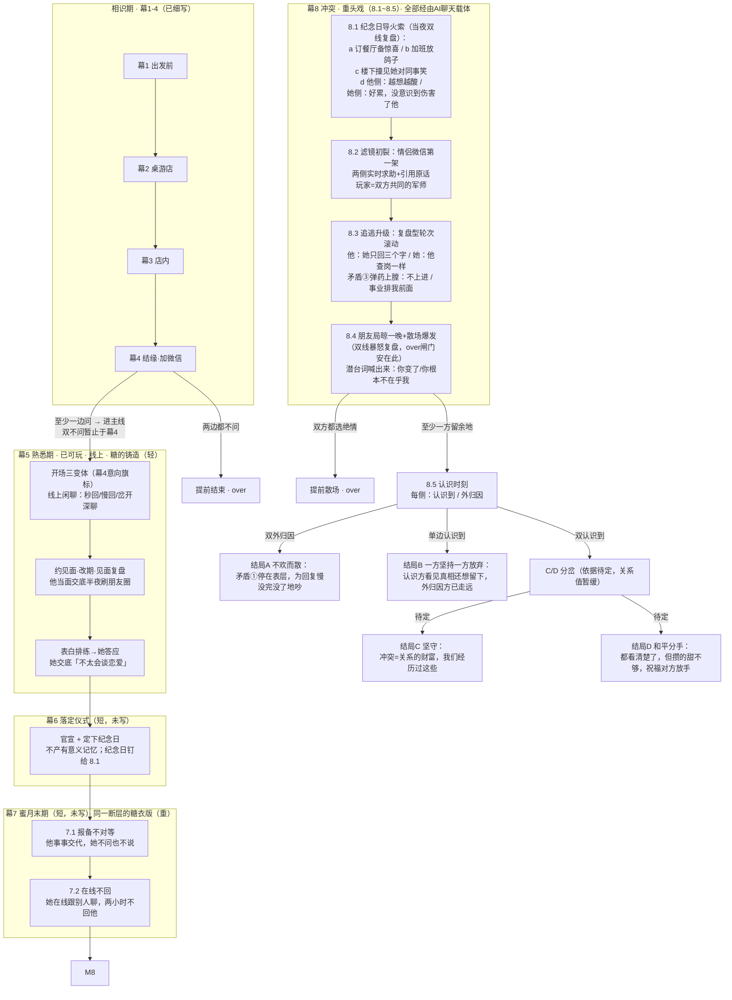
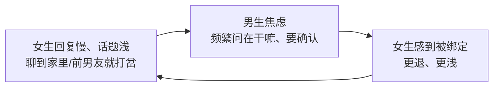

# 游戏宏观大纲（v2 扩充版）

> 2026-11 起：项目入口是 [AGENTS.md](../AGENTS.md)，本文件是宏观定稿层；个别早期段落（如三条矛盾引擎里已被降为背景的"无动力"线）存在历史残留，以 AGENTS.md 与 script/ch*.yaml 为准。
> **2026-11-06 工作模型**（讨论对齐、骨架未出、剧本未写）：幕6=官宣+纪念日定档；幕7=报备不对等 + 在线不回，与幕8 同一断层、5 轻 7 重；关系值暂缓、C/D 分岔依据待定。记忆见「幕5+幕7 记忆经济」一节——其中「自糖」、自白/自糖的具体短句、槽位 8 还是 9，仍待拍板。

> 宏观层，位于 ch3/ch4/ch5 细节层之上。
> v2 变更：幕1-4 统一叫「相识期」；幕8 节拍改编号 8.1~8.5；新增三大矛盾引擎、纪念日导火索事件细案、中途 over 闸门。关系值曾列入 v2，**2026-11-05 起暂缓**，不作承诺。
> 载体铁律（写作时时刻自检）：剧本唯一载体是「角色↔AI」聊天轮次，情侣互动永不直接出现，只能经由「转述复盘 / 实时求助 / 引用原话」进入聊天，详见「载体规则」一节。

## 一句话主题

恋爱初期的滤镜本质是投射：匮乏的人把自己缺的东西投到对方身上，以为对方能填补自己；熟悉让滤镜褪去，露出一个和自己一样的普通人。此刻的选择——换掉，还是认清幻想与真实的落差后仍然留下——交给玩家，游戏不评判。

## 玩法与主题的咬合

- 玩家 = 同一个 AI，同时在男生、女生两部手机里。
- 全游戏只有玩家同时看到两侧视角；两个角色各自只见自己的一半——这就是「通过 AI 看到两个人冲突」。
- 幕8 里玩家给两边的建议分别决定每个人走向「认识到」还是「外归因」，结局由两侧旗标组合而成。机制本身即主题：能看见全貌的只有玩家。

## 人物内核

男生（焦虑型）：
- 外冷内热，看着社恐不爱社交，内心其实能敞开。
- 家庭条件不错，但生活无趣、没冲劲，孤独，缺乏动力。
- 匮乏：渴望被热情点燃、被回应，渴望有人拉他出一个人的世界。

女生（回避型）：
- 看着热情开朗，实际是对深层关系的恐惧——情感广而浅，不敢深入。
- 独立、事业心强，不愿敞开内心，物质上要靠自己奋斗。
- 匮乏：渴望一个稳定、无条件接得住自己的容器。

投射与破灭的镜像（爱上的特质 = 爆雷的特质）：

| 相识期读到的是 | 冲突期看到的是 |
|---|---|
| 女生的热情开朗 | 热情给所有人，唯独深入不进来 |
| 女生的独立上进 | 不需要他，事业永远在他前面 |
| 男生的稳重接纳 | 稳=低能量没主见，冲突一来就焦虑上头 |
| 男生的家境 | 物质宽裕但情感荒漠，不懂她的挣扎 |

## 全游戏结构

相识期（幕1-4，已可玩）→ 结缘岔口 → 幕5 熟悉期（已可玩，线上、糖的铸造）→ 幕6 落定仪式（短，未写）→ 幕7 蜜月末期（短，未写，与幕8 同一断层）→ 幕8 冲突（重头戏）→ 幕9 抉择与结局。

## 宏观总图

## 章法：矛盾驱动，一路多开

全剧抓住 2~3 个核心矛盾。**同一个矛盾，在不同结局线里有不同展开**——不写「一个事件只通向一个走向」的流水账，而是矛盾摆在那里，A 线是它的表层循环，C 线是它的深层解法。这样每条结局线都天然有章法可循。

## 三大矛盾引擎

### 矛盾①（主引擎，必保）：浅层热情 ⟷ 确认饥渴

追逃循环闭环：

- 心动期读法：她是好忙好独立；他是好在乎我（被完美的人一直关心，安全感+幸福）。
- 真相：男生只是因为回应少心里急，想多聊聊把关系往前推——**这恰恰是女生想要但藏起来的东西**；女生不是不喜欢，是不愿暴露内心、不知道怎么表达（不是不喜欢你这个人，只是我不熟悉这样，我不知道怎么回应）。
- 层次（2026-11-06）：**幕5 轻、幕7 重、幕8 才吵开**。幕5 只是端倪，双方都不烦——他的焦虑指向「想靠近」（秒回、在干嘛、半夜刷朋友圈），她的回避指向「保持节奏」（慢回、岔开深聊）。幕7 已是爆发前期：同一套内核在，人还忍着，只跟 AI 吐槽、双方不开吵。他的焦虑转向「要透明」（报备、翻她的社交记录、疑心）；她的回避转向「关闸」（对最近的人懒得解释，第一次觉得烦、烦完又愧疚）。幕8 才把遮掩形态喊出来（视奸、查岗、「你变了」），真实内核（他怕被抛下、她怕被吞没）仍然不由角色自己说破。
- 爆发形态（幕8）：男生指责她敷衍、不在乎、冷漠，要求她变热情主动；女生越被要求越冷。真实记录里整场架都停在遮掩形态（「你对谁都热络唯独不跟我分享」「你视奸我 / 你太闲」），内核一个字不出现——这就是 8.5 存在的理由。
- 各结局展开：
  - A：为这事没完没了地吵。男生一直指责，女生冷漠回应，永远停在表层，谁也不往深走一步。
  - B：一方先停下来看见真相，另一方还在原地指责。
  - C：男生认识到——她就是这样的人，我为什么要求她必须敞开心扉？女生认识到——他只是想跟我沟通，我应该把我的不适应说出来：不是不喜欢你这个人，只是我不熟悉这样，不知道怎么回应。

### 矛盾②（导火索事件×2）：对外人热络 ⟷ 对爱人疏远

- 8.1 纪念日事件（小，私下）：纪念日撞加班+楼下撞见她对同事笑（细案见下节）。
- 8.4 朋友局事件（大，当众）：她招呼全场热络、唯独晾着他，散场路上爆发至暗大吵。
- 它们是矛盾①的两次具象化引爆：一次私下、一次当众，强度递进。

### 矛盾③（背景级）：生活动力落差

- 男生对什么都「行、挺好的、随便」→ 没主见没冲劲（伏笔埋着，不单独放大冲突）。
- 爆发时作为吵架弹药出现：女生骂他无聊、不上进、没前途；男生觉得她的世界里事业永远排他前面。
- 呼应两人出身：他物质宽裕但情感荒漠；她一无所有所以只能拼。

## 幕5~7（2026-11-06）

旧稿里的「幕5 关系值微调 / 按关系值决定谁表白 / 幕6 才告白 / 幕7=周末改期」作废。表白与答应已在幕5 写完（`script/ch5.yaml`，引擎可玩）。幕6、幕7 **事件已选，骨架和剧本都还没写**。

**幕5 和幕7 不是重复的两章，是同一条断层的两个采集阶段：**

| | 幕5 熟悉期（已可玩） | 幕7 蜜月末期（未写） |
|---|---|---|
| 关系 | 还没在一起，线上为主 | 已在一起，线下/共同生活的信号 |
| 浓度 | 轻：有端倪，没到让人烦 | 重：8 幕要爆的内核已经在，双方还忍着，只跟 AI 吐槽 |
| 滤镜 | 被动生成。糖在这里铸出来 | 主动维护。行为开始不体面，要花力气才盖得住 |
| 功能 | 第一轮「对方行为 + 我的理解」，外加一次说漏 | 同一轮的加深版，并补上「我以为我自己是谁」 |

**幕6 落定仪式（已选 A2+A3，短，未写）。** 表白不在这章。内容=他想官宣、她犹豫要不要发 + 顺势把「在一起纪念日」定下来。不产有意义记忆。纪念日是 8.1 的钉子：后面「说好要好好过的日子」指的就是这一拍。分叉只落旗标、结构汇合（官宣发不发、纪念日算哪一天），具体几路等骨架。

**幕7 与幕8 必须是同一条断层，不是另一桩琐事。** 断层一句话：**她的生活他进不去，他的确认她不想接。** 8.1 撞见她对同事笑、8.3 查岗、8.4 朋友局被晾，都是这条断层换了个表面。幕7 埋的是它还没发作的那一次，这样到幕8 才是「又是这个，还是没变」，而不是第一次就分手。

- **7.1 报备不对等（已选 B2）。** 他出门必报「跟谁、在哪、几点回」；她从不问他，也不说自己。他读作「她不查岗，对我放心」（真相是没兴趣知道）；她读作「他大事小事都交代，做事有谱」（真相是用报备换注意力）。这是 8.3 查岗的糖衣版。
- **7.2 在线不回（已选 D1）。** 约好的前夜他发消息确认，她两小时不回；他刷到她五分钟前还在别人动态底下聊。她深夜回「刚才刷忘了」，完全没觉得有事。这是 8.1 的聊天版：对不熟的人热络秒回，对最近的人懒得演。**不做成把幕8 翻倍的真岔路**——替对方找理由 / 如实点破只落旗标，后面 1～2 句回声，结构汇合。原案「答应了又因工作改期」作废（幕5 已用过改期，且和这条断层不对轴）。

幕7 自白要写到「不太好、不太健康」那一层，不能停在恋爱初期的可爱焦虑。男生是疑心和视奸萌芽（翻她的社交记录、数她给谁评论，自己觉得不对但停不下来），不是「盯着屏幕等了两小时」那种甜。女生是内心（对他懒得解释、烦完又觉得自己没良心），不是表面行为。具体短句待拍板，见记忆经济。

写作顺序（用户 2026-11-06 定）：先事件（本节）→ 骨架、分叉、记忆放在同一步 → 简化流程图贴飞书 → 才填①②③④。记忆门本身就是分叉，不单独后补。

## 幕5+幕7 记忆经济（2026-11-06 工作模型）

每个窗里是三台摄像机，不是三个阶段。对象 × 内容：

| | 真实 | 误读（滤镜） |
|---|---|---|
| 对方 | **钥匙**：TA 是谁。事实。**只有它开门** | **糖**：我以为 TA 是谁。滤镜 |
| 自己 | **自白**：我是谁。说漏给 AI 的，最多半觉察（「知道有病但停不下来」）。不跨窗 | **自糖**：我以为我是谁。全然真诚的自我解释（监控=关心，疏远=太忙）。幕7 行为开始不体面才开机，幕5 不回炉 |

自白和钥匙不是同一件事，也不该是：一个是「我的模式」，一个是「TA 的行为」，中间夹着滤镜。把这两件事连成因果的是 8.5 的 AI 和看双窗的玩家，角色自己不做。

**8.5 怎么用（零件拼装，不预写组合）：**

- 分支只由钥匙管。存了幕5 的钥匙、幕7 的钥匙，或两把都存，就在**同一个位置**多一个「认识到」选项，引用对应那次的证据。后面走向不变，只差那一两句。
- 糖、自白、自糖不加选项，只往回复里加段落。认识到 = 钥匙段 + 糖段（点名你当时的误读）+ 自糖段（点名你当时怎么解释自己）+ 自白段（把你自己的话甩回去）。没存哪类就少哪段。
- 外归因永远可选。有糖时用法反转：你存的「都会回」变成「她变了」的前科。
- 一把钥匙都没有：「认识到」灰显，只能外归因，进 A/B。这是保底出口。
- 剧本按段写（每窗：钥匙段×2、糖段×2、自白段×2、自糖段×1），引擎按持有情况拼。持有组合不进剧本工作量。这依赖此前搁置的「回复按记忆池出变体」，幕8 再做引擎，不挡幕6/7 的写作。

**已落地的幕5 产出（`script/ch5.yaml`，标签不显示类型）：**

- 男窗：钥匙「不会谈恋爱」、糖「都会回」、自白「八百条在干嘛」；干扰「猫叫煤球」「想吃烤肉」（纯占位）。
- 女窗：钥匙「半夜刷朋友圈」、糖「家里有爱」、自白「怕太深入」；干扰「头像是小熊」「同桌是表妹」（纯占位）。
- 幕1–4 的教学记忆在本窗幕5 开场清空，不进这套账。幕5 的记忆留到幕8，中间不清。

**幕7 拟产出（每窗四条有意义，短句未定）：** 一把新钥匙（男=她在线不回；女=他事事报备）、一颗新糖（男=「她不查岗=放心」；女=「他对我的生活感兴趣=在乎」）、一条自白、一条自糖。自白、自糖的候选原话还在聊，未选。自糖入不入记忆池：按世界观应入（阅后即焚，AI 只能引用玩家存下的话）；此条仍等你口头确认。

**槽位（方法论已定，数字未定）：** 先保证正牌放得下、认识到必能触发，再加 1～2 格余量，避免手滑存了垃圾就开不了门。若幕7 的自白和自糖都入池：每窗有意义 7 条，推荐槽位 9。若自糖不入池：有意义 6 条，推荐 8。

**无意义记忆分两种，用来制造取舍，不进幕8 的门：** 回声型在幕6/7 内部用「需记忆」消化掉（存了有一句甜回调，没存就灰）；纯占位型从头到尾没有回报。幕6/7 各准备几条、写什么，跟骨架一起定。幕5 已有的四条干扰都是纯占位。

## 载体规则：吵架怎么名正言顺地进AI聊天（幕8写作的第一约束）

剧本的唯一载体是「角色 ↔ AI」的聊天轮次。情侣之间的互动**永远不直接出现在剧本里**，只能通过三种方式进入聊天。每拍开写前做动机检测：**背景情况能合理解释「这个人此刻确实在跟AI聊」即可**——比如两人本来就在家刷手机、睡前习惯性找AI唠两句、受了挫想找人倒苦水。不设固定清单，能站得住就行；背景撑不住的轮次=角色在给玩家演话剧，穿帮。

### 三种进入方式

1. **转述复盘（事后，主通道）**：吵完/受挫后，各自把事情倒给AI听。关键：**两个人讲的是同一场架，版本却完全不同**——男生版：「她对谁都热情，唯独对我最疏远」；女生版：「他今天突然来楼下，还挺惊喜的，但我真的好累，感觉他不太开心，是我做错什么了吗」。玩家拿到两份带偏见的叙事，并排对照才接近真相。**信息差即张力**。
2. **实时求助（事中，战术通道）**：吵架进行中躲进房间/工位，问AI「她回我"随便"是什么意思」「我该不该现在道歉」。此刻玩家的回复会变成角色发给对方的话——**玩家是两个人的共同军师，亲手给双方的战书和情书执笔**。
3. **引用原话（文本道具）**：把对方的消息截图/引用给AI看。吵架原文以引文形式出现在①用户消息栏里，剧本从未离开聊天界面半步。

### 幕8各拍的载体分配

- 8.1 纪念日：当夜双线复盘。他侧：越想越酸；她侧：累+根本没意识到伤害了他。同一场楼下的相遇，两个版本并排放给玩家。
- 8.2 初裂：情侣微信上的第一场架——两侧实时求助+引用原话，玩家眼看自己写的回复把火烧大或压小。
- 8.3 追逃升级：低烈度日常，复盘型轮次滚动（他：她今天又只回三个字；她：他查岗一样问在干嘛）。玩家两侧各劝各的。
- 8.4 朋友局+至暗：散场后双线暴怒复盘；**over闸门与绝情选项就安在这两轮AI对话里**。
- 8.5 认识时刻：AI 对话本身就是裁决现场。选项由钥匙决定；回复按记忆池拼装（钥匙段、糖段、自糖段、自白段）。

## 幕8-1 纪念日事件细案（8.1 导火索）

- 铺垫：男生提前订好餐厅、准备纪念日惊喜，指望这顿饭找回热恋感。
- 8.1a：女生临时加班，说改天补上——她真心觉得工作优先很正常，不是敷衍他。
- 8.1b：男生不甘心，带着宵夜去公司楼下等，撞见女生和同事有说有笑走出来——**那是他当初心动时的同款笑声**。
- 8.1c：轮到他上前，女生瞬间收起笑：「你怎么来了，不是说改天吗」，疲惫敷衍，只想回家。
- 8.1d：男生当场没发作，回家越想越酸：对谁都热情，唯独对我最疏远。
- 内核注解（只有玩家可见的双侧真相）：女生对外的有说有笑是浅层社交保护壳——对不熟的人反而轻松；对他「冷淡」是因为把他当成能松口气的安全区，**恰恰是信任的表现**。男生读到的是「我不特殊」。巨大信息差。
- 8.2 滤镜初裂由此引爆：他发现「她对谁都热情，唯独对我最疏远」；她发现「他不是稳，是闷，一有情绪就黏上来要确认」。

## 幕8 节拍（8.1~8.5）

- 8.1 小导火索：纪念日事件（细案如上）。
- 8.2 滤镜初裂：第一次争吵，双方第一次看见对方「滤镜外」的样子。
- 8.3 追逃循环升级：多轮拉扯。焦虑型追（要回应、要确认、翻旧账「你以前不是这样的」），回避型逃（加班、冷淡、「你能不能成熟点」）。
- 8.4 至暗点：导火索二（大事引爆）——女生的朋友局，男生全程被晾：她对谁都热络，唯独顾不上他。散场路上他绷不住爆发，她一句「你能不能成熟点」点燃大吵，潜台词喊出来（表面：「你变了」「你根本不在乎我」；底层：你没有满足我的期待——潜台词不说破）。**over 闸门**：若双方在此都选了绝情选项，当场散场结束（同幕4 逻辑）。
- 8.5 认识时刻：每侧外归因永远可选；「认识到」由本窗钥匙开门（幕5、幕7 各一把，同一位置，存了哪把就用哪次的证据，不另开结构）。糖 / 自白 / 自糖只加厚那一两句：对 TA 祛魅（钥匙对糖），对自己祛魅（自白对自糖——「你说你是忙，可你自己也说过懒得解释」）。详见「幕5+幕7 记忆经济」。旧稿「每侧二选一」作废。

## 关系值（分值，轻量）——【2026-11-05 起暂缓】

- **当前状态：先不搞数值。** C/D 终局分岔的依据待定（原案"关系值高走 C 低走 D"仅作历史参考，不作承诺）。
- 历史原案（留档）：初值幕4 双问=高、单问=低；作用延后设计。
- 定位：作品集层面轻量示意即可，不做复杂数值系统。

## 幕9 结局矩阵

| 男生 | 女生 | 结局 |
|---|---|---|
| 外归因 | 外归因 | A 不欢而散：吵的从来不是事，是各自没被满足的匮乏 |
| 认识到 | 外归因（或反之） | B 一方坚持，一方放弃 |
| 认识到 | 认识到 | 双认识到后分岔进 C/D：**分岔依据待定（2026-11-05，关系值方案暂缓）**。D 是 C 的变体，共用 8.5 之后的轮次，只在最后一拍分岔 |

## 精神分析层的表达方式

不给角色讲理论。用行为让观众自己看出：A 结局里两人吵的从来不是事情本身，而是各自未被满足的匮乏；C 结局的转机不是「问题解决了」，而是「看清楚了还愿意留下」。

## 作品集篇幅策略

- 相识期（幕1-4）：已细写，约占前三分之一。
- 幕8：全细节开发，作品集核心展示位。
- 幕5：已可玩，幕8 的第一批弹药（线上、轻）。
- 幕6、幕7：事件已选（2026-11-06），骨架和剧本未写。幕7 是幕8 同一断层的糖衣版，不是独立琐事。
- 幕9：每个结局一小段收尾。
