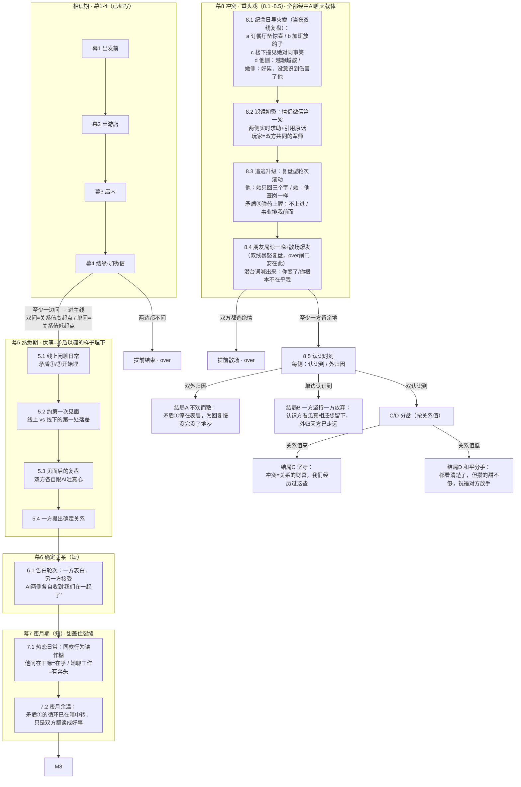
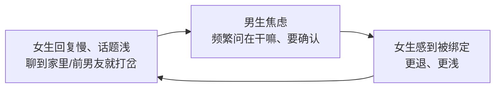

# 游戏宏观大纲（v2 扩充版）

> 宏观层，位于 ch3/ch4 细节层之上。
> v2 变更：幕1-4 统一叫「相识期」；幕8 节拍改编号 8.1~8.5；新增三大矛盾引擎、纪念日导火索事件细案、中途 over 闸门、关系值分值。
> 载体铁律（写作时时刻自检）：剧本唯一载体是「角色↔AI」聊天轮次，情侣互动永不直接出现，只能经由「转述复盘 / 实时求助 / 引用原话」进入聊天，详见「载体规则」一节。

## 一句话主题

恋爱初期的滤镜本质是投射：匮乏的人把自己缺的东西投到对方身上，以为对方能填补自己；熟悉让滤镜褪去，露出一个和自己一样的普通人。此刻的选择——换掉，还是认清幻想与真实的落差后仍然留下——交给玩家，游戏不评判。

## 玩法与主题的咬合

- 玩家 = 同一个 AI，同时在男生、女生两部手机里。
- 全游戏只有玩家同时看到两侧视角；两个角色各自只见自己的一半——这就是「通过 AI 看到两个人冲突」。
- 幕8 里玩家给两边的建议分别决定每个人走向「认识到」还是「外归因」，结局由两侧旗标组合而成。机制本身即主题：能看见全貌的只有玩家。

## 人物内核

男生（焦虑型）：
- 外冷内热，看着社恐不爱社交，内心其实能敞开。
- 家庭条件不错，但生活无趣、没冲劲，孤独，缺乏动力。
- 匮乏：渴望被热情点燃、被回应，渴望有人拉他出一个人的世界。

女生（回避型）：
- 看着热情开朗，实际是对深层关系的恐惧——情感广而浅，不敢深入。
- 独立、事业心强，不愿敞开内心，物质上要靠自己奋斗。
- 匮乏：渴望一个稳定、无条件接得住自己的容器。

投射与破灭的镜像（爱上的特质 = 爆雷的特质）：

| 相识期读到的是 | 冲突期看到的是 |
|---|---|
| 女生的热情开朗 | 热情给所有人，唯独深入不进来 |
| 女生的独立上进 | 不需要他，事业永远在他前面 |
| 男生的稳重接纳 | 稳=低能量没主见，冲突一来就焦虑上头 |
| 男生的家境 | 物质宽裕但情感荒漠，不懂她的挣扎 |

## 全游戏结构

相识期（幕1-4，已细写）→ 结缘岔口 → 幕5 熟悉期（埋伏笔）→ 幕6 确定关系 → 幕7 蜜月期（短）→ 幕8 冲突（重头戏）→ 幕9 抉择与结局。

## 宏观总图

## 章法：矛盾驱动，一路多开

全剧抓住 2~3 个核心矛盾。**同一个矛盾，在不同结局线里有不同展开**——不写「一个事件只通向一个走向」的流水账，而是矛盾摆在那里，A 线是它的表层循环，C 线是它的深层解法。这样每条结局线都天然有章法可循。

## 三大矛盾引擎

### 矛盾①（主引擎，必保）：浅层热情 ⟷ 确认饥渴

追逃循环闭环：

- 心动期读法：她是好忙好独立；他是好在乎我（被完美的人一直关心，安全感+幸福）。
- 真相：男生只是因为回应少心里急，想多聊聊把关系往前推——**这恰恰是女生想要但藏起来的东西**；女生不是不喜欢，是不愿暴露内心、不知道怎么表达（不是不喜欢你这个人，只是我不熟悉这样，我不知道怎么回应）。
- 爆发形态（幕8）：男生指责她敷衍、不在乎、冷漠，要求她变热情主动；女生越被要求越冷。
- 各结局展开：
  - A：为这事没完没了地吵。男生一直指责，女生冷漠回应，永远停在表层，谁也不往深走一步。
  - B：一方先停下来看见真相，另一方还在原地指责。
  - C：男生认识到——她就是这样的人，我为什么要求她必须敞开心扉？女生认识到——他只是想跟我沟通，我应该把我的不适应说出来：不是不喜欢你这个人，只是我不熟悉这样，不知道怎么回应。

### 矛盾②（导火索事件×2）：对外人热络 ⟷ 对爱人疏远

- 8.1 纪念日事件（小，私下）：纪念日撞加班+楼下撞见她对同事笑（细案见下节）。
- 8.4 朋友局事件（大，当众）：她招呼全场热络、唯独晾着他，散场路上爆发至暗大吵。
- 它们是矛盾①的两次具象化引爆：一次私下、一次当众，强度递进。

### 矛盾③（背景级）：生活动力落差

- 男生对什么都「行、挺好的、随便」→ 没主见没冲劲（伏笔埋着，不单独放大冲突）。
- 爆发时作为吵架弹药出现：女生骂他无聊、不上进、没前途；男生觉得她的世界里事业永远排他前面。
- 呼应两人出身：他物质宽裕但情感荒漠；她一无所有所以只能拼。

## 幕5~7 轮次级走向（熟悉期 → 确定关系 → 蜜月期）

幕5 熟悉期（线上为主，每拍都是「矛盾以糖的样子出现」）：
- 5.1 线上日常（多拍）：
  - 女生回复慢、话题浅、聊到家里或前男友就打岔 → 男生侧读作「她好忙好独立」；玩家在她侧看到的是「其实聊得挺开心，就是不知道怎么往下说」。
  - 男生秒回、频繁问「在干嘛」→ 女生侧读作「被完美的人一直关心，好有安全感」。
  - 男生对什么都「行、挺好的、随便」→ 她侧读作「稳重随和，跟他在一起不用操心」。
  - 关系值微调拍：玩家的建议影响关系值（如劝男生「别问太勤，给她空间」→ 关系值+）。
- 5.2 约第一次见面：谁开口、计划谁定——「随便」首次显形：男生侧「都听她的」；女生侧「答应得爽快，但当天临时改了一次时间」。
- 5.3 见面后复盘（双侧各一轮）：
  - 男生跟AI：「今天挺好的，就是她一直在看手机回消息，不过她工作忙嘛。」（玩家知道：她在躲累话题）
  - 女生跟AI：「他全程没意见，去哪都我说了算，有点怪，但也省心。」（玩家知道：他不是没意见，是怕提了被否）
- 5.4 确定关系提案：按关系值/旗标决定谁先开口（高温=男生鼓起勇气；低温=女生顺水推舟）。

幕6 确定关系（短，一拍）：告白→答应→AI两侧各自道贺——同一时刻两份欢喜，玩家的祝贺词分侧写。

幕7 蜜月期（短，两三拍）：
- 7.1 热恋日常：矛盾①的循环已在转，但全部被读成糖——他一醒来就发「在干嘛」=在乎；她聊工作规划=有奔头。
- 7.2 蜜月余温（收尾拍）：小别扭第一次冒头（他约她周末，她答应了又因工作改期），但双方各自跟AI消化掉，都替对方找了理由。**玩家的选择首次可以不替对方找理由（关系值-）或顺着找（关系值+）**。

## 载体规则：吵架怎么名正言顺地进AI聊天（幕8写作的第一约束）

剧本的唯一载体是「角色 ↔ AI」的聊天轮次。情侣之间的互动**永远不直接出现在剧本里**，只能通过三种方式进入聊天。每拍开写前做动机检测：**背景情况能合理解释「这个人此刻确实在跟AI聊」即可**——比如两人本来就在家刷手机、睡前习惯性找AI唠两句、受了挫想找人倒苦水。不设固定清单，能站得住就行；背景撑不住的轮次=角色在给玩家演话剧，穿帮。

### 三种进入方式

1. **转述复盘（事后，主通道）**：吵完/受挫后，各自把事情倒给AI听。关键：**两个人讲的是同一场架，版本却完全不同**——男生版：「她对谁都热情，唯独对我最疏远」；女生版：「他今天突然来楼下，还挺惊喜的，但我真的好累，感觉他不太开心，是我做错什么了吗」。玩家拿到两份带偏见的叙事，并排对照才接近真相。**信息差即张力**。
2. **实时求助（事中，战术通道）**：吵架进行中躲进房间/工位，问AI「她回我"随便"是什么意思」「我该不该现在道歉」。此刻玩家的回复会变成角色发给对方的话——**玩家是两个人的共同军师，亲手给双方的战书和情书执笔**。
3. **引用原话（文本道具）**：把对方的消息截图/引用给AI看。吵架原文以引文形式出现在①用户消息栏里，剧本从未离开聊天界面半步。

### 幕8各拍的载体分配

- 8.1 纪念日：当夜双线复盘。他侧：越想越酸；她侧：累+根本没意识到伤害了他。同一场楼下的相遇，两个版本并排放给玩家。
- 8.2 初裂：情侣微信上的第一场架——两侧实时求助+引用原话，玩家眼看自己写的回复把火烧大或压小。
- 8.3 追逃升级：低烈度日常，复盘型轮次滚动（他：她今天又只回三个字；她：他查岗一样问在干嘛）。玩家两侧各劝各的。
- 8.4 朋友局+至暗：散场后双线暴怒复盘；**over闸门与绝情选项就安在这两轮AI对话里**。
- 8.5 认识时刻：AI对话本身就是裁决现场——玩家回复的措辞决定各自归因方向。

## 幕8-1 纪念日事件细案（8.1 导火索）

- 铺垫：男生提前订好餐厅、准备纪念日惊喜，指望这顿饭找回热恋感。
- 8.1a：女生临时加班，说改天补上——她真心觉得工作优先很正常，不是敷衍他。
- 8.1b：男生不甘心，带着宵夜去公司楼下等，撞见女生和同事有说有笑走出来——**那是他当初心动时的同款笑声**。
- 8.1c：轮到他上前，女生瞬间收起笑：「你怎么来了，不是说改天吗」，疲惫敷衍，只想回家。
- 8.1d：男生当场没发作，回家越想越酸：对谁都热情，唯独对我最疏远。
- 内核注解（只有玩家可见的双侧真相）：女生对外的有说有笑是浅层社交保护壳——对不熟的人反而轻松；对他「冷淡」是因为把他当成能松口气的安全区，**恰恰是信任的表现**。男生读到的是「我不特殊」。巨大信息差。
- 8.2 滤镜初裂由此引爆：他发现「她对谁都热情，唯独对我最疏远」；她发现「他不是稳，是闷，一有情绪就黏上来要确认」。

## 幕8 节拍（8.1~8.5）

- 8.1 小导火索：纪念日事件（细案如上）。
- 8.2 滤镜初裂：第一次争吵，双方第一次看见对方「滤镜外」的样子。
- 8.3 追逃循环升级：多轮拉扯。焦虑型追（要回应、要确认、翻旧账「你以前不是这样的」），回避型逃（加班、冷淡、「你能不能成熟点」）。
- 8.4 至暗点：导火索二（大事引爆）——女生的朋友局，男生全程被晾：她对谁都热络，唯独顾不上他。散场路上他绷不住爆发，她一句「你能不能成熟点」点燃大吵，潜台词喊出来（表面：「你变了」「你根本不在乎我」；底层：你没有满足我的期待——潜台词不说破）。**over 闸门**：若双方在此都选了绝情选项，当场散场结束（同幕4 逻辑）。
- 8.5 认识时刻：玩家在两侧分别引导，每侧二选一——外归因（都是对方的错，对方变了）vs 内觉察（我爱上的是我的投射，让我失望的那一点恰恰是真实的 TA）。

## 关系值（分值，轻量）

- 全程后台记录，不改主线收束，但留下差别：
- 初值：幕4 双问 = 关系值高；单问 = 关系值低。
- 作用：具体生效方式**延后设计**——等各块的具体轮次剧本成型后再定怎么用，避免现在随便定分类、后期工作量指数增长。目前唯一定死的用途是 **C/D 终局分岔**（双认识到时：关系值高走 C，关系值低走 D）。
- 定位：作品集层面轻量示意即可，不做复杂数值系统。

## 幕9 结局矩阵

| 男生 | 女生 | 结局 |
|---|---|---|
| 外归因 | 外归因 | A 不欢而散：吵的从来不是事，是各自没被满足的匮乏 |
| 认识到 | 外归因（或反之） | B 一方坚持，一方放弃 |
| 认识到 | 认识到 | 双认识到后按**关系值**分岔：关系值高 → C 坚守；关系值低 → D 和平分手（都看清楚了，但攒的甜不够，祝福对方放手）。D 是 C 的变体，共用 8.5 之后的轮次，只在最后一拍分岔 |

## 精神分析层的表达方式

不给角色讲理论。用行为让观众自己看出：A 结局里两人吵的从来不是事情本身，而是各自未被满足的匮乏；C 结局的转机不是「问题解决了」，而是「看清楚了还愿意留下」。

## 作品集篇幅策略

- 相识期（幕1-4）：已细写，约占前三分之一。
- 幕8：全细节开发，作品集核心展示位。
- 幕5：次之，幕8 的对位弹药库，需精确镜像。
- 幕6、幕7：少量轮次示意。
- 幕9：每个结局一小段收尾。
